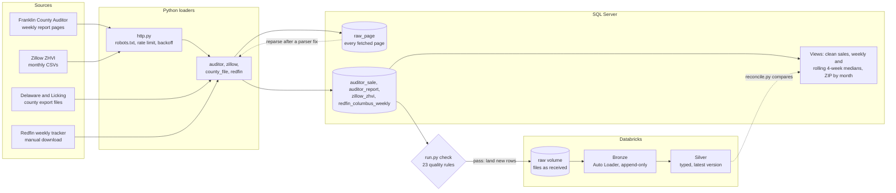

# Columbus Housing Trend Pipeline

[](https://github.com/ryanosborne142980-cpu/columbus_housing/actions/workflows/ci.yml)

Turns Franklin County's weekly home-sale report pages into parcel-level sales data that is checked against the
county's own counts, then carried through bronze and silver tables on Databricks.

The county posts each week's closed sales as a web page and appears to take it down about 30 weeks later. This
pipeline saves every page, parses it, compares the parsed rows with the count the county printed, and stops bad
data before it goes any further. Python and SQL Server do the loading, Databricks holds the lakehouse copy, and
GitHub Actions tests every change against a real SQL Server.

## At a glance

| | |
|---|---|
| **Loaded** | 12,718 sales from 59 weekly reports (April to October 2026), plus 20,071 monthly Zillow rows |
| **Parser check** | 49 of the 50 reports that publish a count match it exactly. The other is the county's miscount: the page lists 336 parcels and its summary says 337. |
| **Quality gate** | 23 rules in [`pipeline/quality.py`](pipeline/quality.py). A failed rule stops the weekly job before anything lands in Databricks. |
| **Reconciliation** | Databricks silver matches SQL Server on 12,038 clean sales: row count, price total and date range, with matching medians for all 31 weeks |
| **Tests** | 55 tests. CI runs them against a SQL Server 2022 container on every pull request. |
| **Decisions** | 8 short [decision records](docs/decisions/README.md) covering what was chosen and what it costs |

Figures were checked on 2026-11-05 and 2026-11-06. Databricks runs on Free Edition, which shows the tools working
end to end, not production scale.

## How it works



One command runs the weekly job, [`scripts/weekly.py`](scripts/weekly.py): load Franklin, check the data, back up
the database, land new rows in Databricks, run bronze and silver, and reconcile. It exits non-zero if any step
fails. Zillow's county file reaches the same volume monthly through
[`land_zillow.py`](databricks/land_zillow.py).

## What to look at

| If you care about | Look at | Why it's there |
|---|---|---|
| Safe re-runs | [`db.insert_new_sales`](pipeline/db.py), [`export.py`](pipeline/export.py) | Sales are keyed on county, parcel, date and price, and exports move a high-water mark only after an upload succeeds. Running anything twice adds nothing. |
| Data you can't get back | [`raw_page`](sql/schema.sql), [decision 0001](docs/decisions/0001-keep-raw-pages.md) | Report pages drop off the county site, so each one is saved before it's parsed. A parser fix is replayed over saved pages with `run.py reparse`, with no network. |
| Failing loudly | [`quality.py`](pipeline/quality.py), [`weekly.py`](scripts/weekly.py) | Rules are split into fail and warn, with checked exceptions written down next to them. Bronze is append-only, so a failed check skips the Databricks steps entirely. |
| Proving two systems agree | [`reconcile.py`](databricks/reconcile.py), [`drift_test.py`](databricks/drift_test.py) | Silver is compared with SQL Server after every run. Schema drift, repeated row versions and bad rows are exercised in a separate bundle target so sample rows can't reach real tables. |
| Lakehouse layers as code | [`bronze.py`](databricks/pipelines/bronze.py), [`silver.py`](databricks/pipelines/silver.py), [`databricks.yml`](databricks/databricks.yml) | Auto Loader into append-only bronze, typed and de-duplicated silver with expectations, all deployed as an asset bundle. |
| Being a good guest | [`http.py`](pipeline/http.py), [decision 0003](docs/decisions/0003-respect-source-access-rules.md) | Every request honors robots.txt and Crawl-delay, is rate limited per host and backs off on 429 and 503. A source that says no is not worked around. |
| Testing SQL as SQL | [`ci.yml`](.github/workflows/ci.yml), [decision 0007](docs/decisions/0007-ci-and-branch-protection.md) | Medians, rolling windows and duplicate-safe inserts live in SQL, so tests run against real SQL Server, not a stand-in. `main` takes pull requests only. |
| How it's operated | [runbook](docs/runbook.md), [CONTRIBUTING.md](CONTRIBUTING.md) | What a healthy run looks like, what each failure means, and how to restore from backup, which has been tested. |

## Sources

| Source | Grain | Cadence | Gives you |
|---|---|---|---|
| Franklin County Auditor weekly sales reports | Parcel-level closed sales by ZIP | Published Sundays (Fri–Thu week) | Ground-truth prices and volume, ZIP-level |
| Delaware / Licking County Auditor sales exports | Parcel-level closed sales | Manual, on request | Same as Franklin, loaded from a file you obtain |
| Redfin Data Center weekly tracker | Columbus metro + Franklin/Delaware/Licking county rows, rolling 4-week | Thursdays | Leading indicators: new listings, pendings, inventory, DOM, price drops |
| Zillow Home Value Index (ZHVI) | Franklin/Delaware/Licking county rows + their ZIPs, monthly, back to 2000 | Monthly (16th) | Long history for YoY and a seasonal baseline; smoothed, seasonally adjusted. **Attribution to Zillow required.** |

## What's loaded so far

Checked 2026-11-05. The other sources above have loaders and sample-file tests, but no real data yet.

| Source | Status |
|---|---|
| Franklin County | 12,718 sales (12,065 residential, 653 commercial) from 59 reports, sold 2026-04-03 to 2026-10-29 |
| Zillow | 20,071 monthly rows: 3 counties and 61 ZIPs, 2000-01 to 2026-09 |
| Redfin | Not loaded |
| Delaware, Licking | Not loaded |

50 of the 59 reports publish a sale count. 49 match the parsed rows. In the other, the page lists 336 parcels and
its summary says 337.

## Setup
Needs SQL Server (default: `localhost`, Windows auth; for a named instance set `COLUMBUS_HOUSING_SERVER`,
e.g. `.\SQLEXPRESS`) and ODBC Driver 18 for SQL Server.
```bash
# Install the dependencies required to fetch, parse, and load the housing data.
pip install -r requirements.txt
```
Data lands in database `columbus_housing` (created on first run). Override with `--server` / `--db`,
or env vars `COLUMBUS_HOUSING_SERVER` / `COLUMBUS_HOUSING_DB`. Schema changes to existing tables are not
applied automatically: `sql/schema.sql` only creates missing tables, while views are recreated on every run.

To use a SQL login instead of Windows auth, set `COLUMBUS_HOUSING_UID` and `COLUMBUS_HOUSING_PWD`.

## Development
```bash
pip install -r requirements-dev.txt   # adds pytest + ruff
ruff check .                          # lint (config in pyproject.toml)
python -m pytest -q                   # uses a throwaway database, columbus_housing_test
```
CI (`.github/workflows/ci.yml`) runs both on every pull request and push to `main`: ruff, then the full
test suite against a SQL Server 2022 container. Work goes through branches and pull requests; merge only
when CI is green.

- [CONTRIBUTING.md](CONTRIBUTING.md): workflow, review checklist, adding a data source
- [docs/runbook.md](docs/runbook.md): running the pipeline, checking results, recovering from failures
- [docs/decisions/](docs/decisions/README.md): why the pipeline works the way it does
- [databricks/](databricks/README.md): bronze and silver layers with Auto Loader, deployed as an asset bundle

## Run
```bash
# Load the Franklin County reports still online (the county appears to keep ~30 weeks).
python run.py auditor --since 2024-10-01      # backfill; stops when weeks run out; incremental after
# Re-parse saved raw pages after a parser fix (no network).
python run.py reparse
# Import a Delaware county sales export from a local Excel or CSV file.
python run.py county-file --county Delaware --file sales.xlsx   # CSV, TSV, .xls or .xlsx
# Download or import the Redfin market-tracker dataset for leading indicators.
python run.py redfin --file <download>         # from https://www.redfin.com/news/data-center/
# Load Zillow home values (monthly; skips files unchanged since the last load).
python run.py zillow                           # or --kind zip --file <CSV from zillow.com/research/data>
# Generate the reports and export every view to CSV files in the target folder.
python run.py report --export out/             # summary + CSVs of every view
# Check the loaded data against the quality rules in pipeline/quality.py. Exits 1 if a rule fails.
python run.py check
# Run the regular weekly job for Franklin County and Redfin data only.
python run.py all --since 2026-10-01           # weekly job (Franklin + Redfin; not county files)
```
The scheduled weekly job is `python scripts/weekly.py` (Mondays; see the [runbook](docs/runbook.md)).
Re-runs are idempotent: loaded reports are skipped, and sales are keyed on county+parcel+date+price.

## Getting the Delaware and Licking files
- **Delaware:** at https://auditor.co.delaware.oh.us/propinfo/ choose The Whole County → Residential → Sold Since a Specific Date. The file arrives by email.
- **Licking:** no public bulk export. Request a residential sales file from the Licking County Auditor's office.

`county-file` finds columns by header name (`COLUMN_HINTS` in `pipeline/county_file.py`) and ignores owner and mailing columns. It keeps residential rows only (land use 500–599, or a class starting with R) and pulls the ZIP from the address when there's no ZIP column. If a load fails, the error lists the file's columns; add the missing header to `COLUMN_HINTS`. Check the logged column map on the first load of each county: matching is by substring, so a generic header like `date` can match the wrong column.

## Views (sql/views.sql)
- `v_sale_clean`: residential only, price >= $10k, multi-parcel deeds collapsed to one sale, per county
- `v_county_week`: weekly count, avg, and median per county
- `v_county_rolling4`: trailing 4-week pooled median + YoY per county. Same construction as Redfin's, so the series line up.
- `v_zip_month`: ZIP x month median + YoY, all counties pooled (some ZIPs cross county lines). YoY is suppressed below 10 sales per side.
- `v_report_validation`: parsed rows vs the county's own count. Non-zero `diff` means the parser has drifted.

## Known limits
- **Zillow data terms:** free for public use with clear attribution to Zillow. `report` prints the source line and `--export` writes `ATTRIBUTION.txt`; keep that line on anything you publish. Zillow's Terms of Use bar scraping, so the loader only downloads the published CSVs, at most once per update. Run it monthly by hand rather than in the weekly job.
- **Franklin reports appear to stay online only ~30 weeks.** Every report page fetched is saved in `raw_page`, so old weeks can be re-parsed after they disappear. Run the weekly job without gaps: a missed week is lost for good, and Franklin YoY needs a full year of captured weeks.
- **Delaware and Licking are manual and only as fresh as your last file.** Their YoY needs two years of history in the export. Fairfield, Union, Madison and Pickaway are still missing.
- **No property attributes** (sqft, beds, year built), so medians move with mix shift. Treat moves under ~3% as noise until you enrich via parcel lookup.
- **The $10k floor is a proxy** for arm's-length sales. It doesn't catch below-market related-party sales or bulk/portfolio deals.
- **Daily Conveyance is robots-disallowed** and deliberately unused. The code honors robots.txt everywhere.
- **Redfin is a manual download.** The legacy S3 weekly file stopped updating in March 2025, the market-tracker paths tried on that bucket return 403, and the new Data Center's links appear to be JS-rendered. Download the weekly file from https://www.redfin.com/news/data-center/ and load it with `--file` (CSV/TSV/gz auto-detected, read in chunks for large files; not yet tried on a real all-US file). `all` skips Redfin unless you pass `--file`. Credit Redfin wherever its data is shown.
- **Parser** was built against the live page structure as of 2026-11-01. Check `v_report_validation` after your first run.
