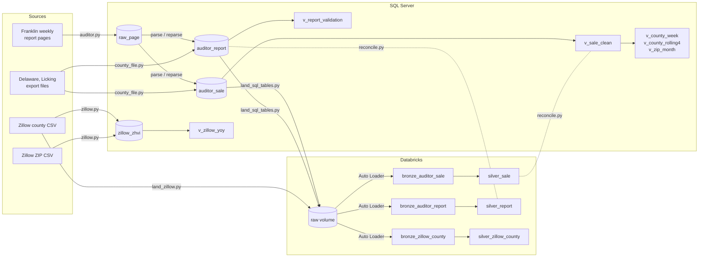

# Lineage

Where each table comes from and what changes on the way. Drawn by hand from the code; nothing checks it.

Two things the diagram makes plain:

- **Zillow reaches Databricks straight from the source file, not through SQL Server.** `zillow_zhvi` and
  `silver_zillow_county` are two separate loads of the same county file. `reconcile.py` doesn't compare them.
- **The clean-sale rules exist twice,** in `v_sale_clean` and in `silver_sale`. A change to one has to be made in
  both. Reconciliation is what catches a miss.

## Each hop

| From | To | Code | What changes |
|---|---|---|---|
| Franklin report page | `raw_page` | [`auditor.py`](../../pipeline/auditor.py), through [`http.py`](../../pipeline/http.py) | Nothing. The page is saved whole, once per distinct content |
| `raw_page` | `auditor_report`, `auditor_sale` | `auditor.py` | HTML tables become rows. The ZIP comes from the table's heading or caption. A sale already loaded is skipped |
| County export file | `auditor_report`, `auditor_sale` | [`county_file.py`](../../pipeline/county_file.py) | Columns are found by header name. Owner and mailing columns are ignored. When the file has a land use column, only residential rows are kept. When it has none, every row with a parcel, date and price loads, and all are labeled residential |
| Zillow CSV | `zillow_zhvi` | [`zillow.py`](../../pipeline/zillow.py) | Three Ohio counties and their ZIPs are kept. One column per month becomes one row per month. Replaced on each load |
| `auditor_sale`, `auditor_report` | `raw` volume | [`export.py`](../../pipeline/export.py), [`land_sql_tables.py`](../../databricks/land_sql_tables.py) | Rows newer than the last high point go out as CSV. `loaded_at` is renamed `source_loaded_at` |
| Zillow county CSV | `raw` volume | [`land_zillow.py`](../../databricks/land_zillow.py) | Nothing. The file name gains Zillow's Last-Modified date |
| `raw` volume | bronze tables | [`bronze.py`](../../databricks/pipelines/bronze.py) | Every value stays a string. `source_file`, `source_modified_at` and `loaded_at` are added |
| bronze | silver | [`silver.py`](../../databricks/pipelines/silver.py) | Types are set, the latest version of each row is kept, and quality rules run |

## Derived columns

| Column | Derived from | How |
|---|---|---|
| `v_sale_clean.parcel_id`, `silver_sale.parcel_id` | `auditor_sale.parcel_id` | The lowest parcel number among rows with the same county, date, price, address and ZIP |
| `parcel_count` | `auditor_sale` rows | The count of those rows |
| `week_start` | `sale_date` | The Monday on or before the sale date |
| `month` (sales) | `sale_date` | Formatted as YYYY-MM |
| `v_report_validation.diff` | `parsed_rows`, `reported_count` | `parsed_rows - reported_count` |
| `median_price`, `median_4wk` | `v_sale_clean.sale_price` | `PERCENTILE_CONT(0.5)` per county and week, or per county over the trailing four weeks |
| `median_yoy_pct`, `sales_yoy_pct`, `zhvi_yoy_pct` | The same measure one year earlier | Percent change, rounded to one decimal |
| `silver_zillow_county.county` | `RegionName` | "Franklin County" becomes "Franklin" |
| `silver_zillow_county.month` | Zillow's month-end column names | The first day of that month |
